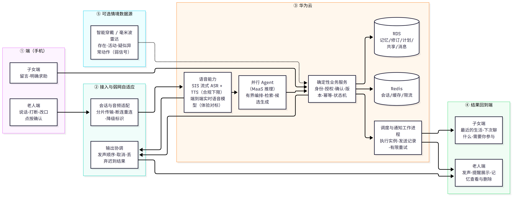
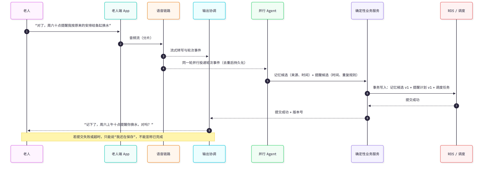
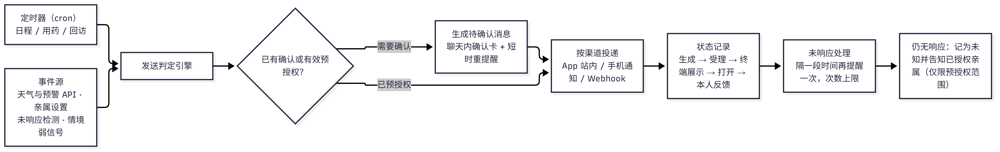
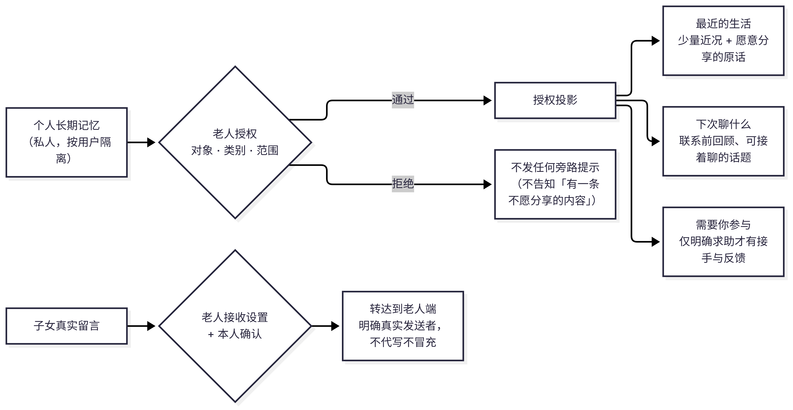

# 云牵晚晴
## 基于华为云 AI 与长期记忆的银发生活助理

> 第十一届华为 ICT 大赛创新赛 · 赛题一（基于华为云产品打造 AI 创新应用）参赛作品
> 大学生创新创业训练计划 · 创业训练项目

| 项目信息 | 内容 |
|---|---|
| 项目名称 | 云牵晚晴——基于华为云 AI 与长期记忆的银发生活助理 |
| 项目类别 | 创业训练 |
| 参赛方向 | 第十一届华为 ICT 大赛创新赛 · 赛题一 |
| 团队规模 | 3 人 |
| 项目周期 | 12 个月 |
| 申请经费 | 1.0 万元 |
| 学院 / 专业 / 学号 / 指导教师 | 待填 |

**阅读说明**：文中插图由 Mermaid 渲染，源文件与重新渲染方法见 `assets/项目书/README.md`。本文中「设计」指已完成设计但尚未编码实现的目标方案，「待验证」指尚无实测数据的技术假设，「已核查」指有官方文档或实际运行证据。三者不混用，也不把架构图当作已交付能力。

---

## 摘要

我国城镇与农村家庭中普遍存在一种错位：老人有强烈的分享与交流意愿，常常发送很长的语音；子女受工作时间与听取场景限制，很难逐条听完、更难记住其中的生活细节，于是老人的表达欲与子女的可投入时间长期不匹配。老人因为「怕打扰孩子」而压抑表达，子女因为「听不完、记不住」而无法真正参与父母的生活，形成一个双方都不满意的循环。

云牵晚晴是一个面向老人的语音生活助理。老人用手机就能与它自然交流，可以随时插话、补充、改口，不必等待 AI 说完；在对话进行的同时，后台 Agent 循环并行工作，把对话中值得保留的生活信息整理为**有来源、可纠正、可删除**的个人长期记忆，并把确认过的生活安排（例如「周六十点提醒我给鱼缸换水」）变成可靠的定时提醒。基于这份记忆，系统能够在合适的时间**主动发起消息**——降温与天气预警、用药与生活安排、身体不适回访、亲属设置的提醒等，做到越用越懂老人。在老人逐项授权下，子女端可以看到的既不只是待办清单，也不只是聊天记录：而是少量近况与老人愿意分享的原话、联系前可以接着聊的话题，以及老人明确的求助。子女可以留下真实的回应，AI 不代写、不冒充。

技术上，本项目把「全双工语音交互」与「长期信息处理」在架构上拆成两层：语音层保证说话可以被打断、被纠正；并行的 Agent 层负责检索、整理与候选生成；所有有副作用的动作（写入记忆、创建提醒、对外共享）都必须经过**确定性业务服务**的校验——身份、授权、确认、版本、幂等、调度——不交给提示词。这一设计同时回应了行业里两个常见失败：全双工语音系统为了时延而放弃记忆深度，或为了记忆深度而牺牲对话流畅。

系统部署在华为云上，使用 CodeArts 进行开发、MaaS 提供 Agent 推理、RDS 持久化个人记忆与提醒计划、Redis 承担会话缓存与限流、ECS + EIP 提供在线可访问的演示环境。全双工语音链路的模型选型尚在实测中，本文给出合规下限路径与体验对标路径的对照，不预设供应商。

项目首版聚焦四件事：手机全双工语音、可靠且可纠正的个人长期记忆、受控的主动提醒与消息、经授权的家庭连接。智能穿戴与毫米波雷达作为可选的情境数据源，用于改善互动时机与提供弱信号提示，不作为安全监护或急救承诺，也不作为首版必备交付。

---

## 一、背景与问题

### 1.1 三类被混在一起的问题

讨论这一问题时常把三件事混为一谈，本项目在设计与验证中严格区分：

| 层次 | 现象 | 本质 |
|---|---|---|
| 表达需求 | 老人愿意讲生活细节、愿意反复讲同一件事 | 关系需要与存在感，不是需要被压缩的噪声 |
| 信息负担 | 长语音里散落着用药、约定、身体状况、家庭往事 | 子女缺少时间与上下文，理解成本高 |
| 现实资源 | 子女忘了、不知道能做什么，或无时间、无能力、无意愿 | 不能靠软件创造家庭的时间与照护资源 |

如果把这三件事都归成「信息处理问题」，产品很容易滑向两个错误：把所有闲聊都变成任务，或把亲情关系变成绩效看板。本项目的立场是：**减少的是整理、寻找和重复交代的负担，不是减少真实交流。**

### 1.2 已有的现实

- 老人普遍使用长语音承载信息与关系，这是智能手机与微信普及后的既有习惯，而不是需要纠正的行为。
- 子女在通勤、会议、育儿间隙听到 60 秒以上的语音，往往只能「听完但没记住」，事后难以复述与行动。
- 重要的生活安排（复诊、取药、缴费、亲友来访、给花换水）散落在闲聊里，没有进入任何提醒工具；对老人而言，现有提醒类 App 的输入成本过高——要打字、要选时间、要理解表单。
- 老人不愿意主动打扰子女，「怕影响孩子工作」是高频表达；这种压抑并非来自缺少通讯工具，而是来自缺少「不打扰也能被接住」的通道。

需要特别说明：以上是访谈与讨论中反复出现的观察，**不是总体统计结论**。本项目不在项目书中声称「所有老人话多」「所有子女都不孝」，相关量化证据将在大创中期报告中补充。

### 1.3 现有方案的三个缺口

1. **通讯工具只负责传输，不负责理解。** 微信、电话解决了「说得出去」，没有解决「听不完、记不住、下次接不上」。
2. **陪聊类产品只负责回话，不负责记忆。** 通用语音助手每次对话几乎从零开始，无法承接「上次说的那个鱼缸」。
3. **健康与照护类产品只负责指标，不负责生活。** 血压、步数、用药记录把老人变成被监测对象，却回答不了子女最想知道的「我妈最近在过怎样的生活」。

---

## 二、国内外现状与差异化定位

不把现有市场说成空白。以下能力描述来自公开产品页与帮助文档的核对，本项目**尚未对这些产品做上手对照实验**；能力存在也不等于对方开放 SDK、在国内同等可用。

| 参照产品 | 已公开的能力 | 本项目需要验证的真实差别 |
|---|---|---|
| 微信 / 电话 + 通用提醒工具 | 熟人交流、另行设置闹钟与待办 | 是否在不损害真实联系的前提下降低整理负担 |
| 小度智能屏 | 语音交互、亲情通话、远程代设提醒 | 不把「老人语音入口」当作本项目独创 |
| ElliQ + 家属应用 | 陪伴对话、提醒、家庭消息与连接 | 个人长期记忆的结构化、可纠正与授权投影是否更合适 |
| Caring Village | 共享任务、责任人、照护计划、角色权限 | 不把「有人接手、有状态」当作唯一创新 |

**差异化定位：**

1. **不是通讯工具，是生活的中转与记忆层。** 老人与子女的交流仍可用微信和电话；本项目负责让下一次交流有上下文、有话题、有温度。
2. **不是通用聊天机器人，是跨会话有用的个人记忆。** 记忆有来源、有时间、有候选与确认状态、可纠正、可删除、按用户隔离。
3. **不是家庭待办中心，是分层的家庭连接。** 生活分享、联系邀请、明确求助是三条不同通路，只有最后一条需要接手与办结状态。
4. **不是被动的问答，是主动的消息。** 系统在获得授权或已确认规则的前提下主动发起提醒与问候，这是「越用越懂老人」的具体形态。
5. **不是监测设备，硬件是可选的耳朵。** 手机即可完整使用；穿戴与雷达只提供额外情境，不构成安全承诺。

---

## 三、目标与内容

### 3.1 项目目标

构建一个**老人可独立受益**的语音生活助理：老人不用学习表单和菜单，说话就能记事、能被提醒、能被回访；在老人授权范围内，为子女提供理解父母、延续交流与参与具体帮助的通道。

**一句话目标**：让老人说过的重要事情不随一次对话结束而消失，并在本人可控的范围内，在合适的时候得到帮助。

### 3.2 三条价值线

```text
线一（老人自身）  自然闲聊／补充／改口
                     ├→ 允许保留的重要信息 → 个人长期记忆 → 下次接着聊、纠错或删除
                     └→ 生活安排候选 → 确认／有效预授权 → 持久化定时任务 → 执行与反馈

线二（主动帮助）  记忆 + 授权情境 + 事件源
                     ├→ 定时提醒（日程、用药、生活安排）
                     ├→ 情境消息（降温预警、天气预警、未响应重提醒）
                     └→ 回访（身体不适、上次未完的话题）

线三（家庭连接）  获准分享的内容 → 授权投影
                     ├→ 少量近况 + 愿意分享的原话
                     ├→ 联系前回顾、可以接着聊的话题
                     └→ 明确求助 → 接手／协商／反馈
                    子女真实留言 → 按老人接收设置转达
```

三条线共用同一份个人长期记忆和同一套确定性业务服务，不是三个独立产品拼在一起。

### 3.3 功能分级

| 优先级 | 功能 | 说明 |
|---|---|---|
| P0 首版核心 | 手机全双工语音对话（打断、补充、改口） | 分段录音不计入完成 |
| P0 | 并行 Agent：记忆候选、提醒候选、共享候选 | 对话不因后台处理而卡顿 |
| P0 | 个人长期记忆：来源、候选/确认、跨会话检索、纠错、删除 | 跨用户隔离 |
| P0 | 定时提醒：创建、查询、修改、取消、反馈 | 版本化、幂等、重启不丢 |
| P0 | 主动消息：日程提醒、未响应重提醒、天气降温提醒 | 见 §4.6 矩阵 |
| P0 | 子女端三入口 + 真实留言 | 无待办时仍有价值 |
| P1 扩展 | 用药提醒（仅基于已核对来源）、身体不适回访、亲属主动设置提醒 | 不做剂量推导 |
| P1 | 天气预警（寒潮、台风、沙尘暴等） | 依赖公开气象 API |
| P2 可选 | 智能穿戴 / 毫米波雷达情境数据源 | 弱信号，非监护 |
| P2 可选 | 疾控信息（按省市粒度） | 需合规评估后实施 |
| 不做 | 诊断、开方、改药、急救、安全监护、代理监护认定 | 见 §6.2 |

---

## 四、技术方案

### 4.1 总体架构

架构分四层：**端（手机）— 接入与弱网自适应 — 云（华为云）— 可选情境数据源**。核心原则是：语音层不直接写库，Agent 层不直接决定权限，所有副作用经确定性业务服务校验。



> **图 1 总体架构。** ①端 → ②接入与弱网自适应 → ③华为云 → ④结果回到端，⑤为可选情境源。实线为主链路，虚线为可选通路（智能穿戴/毫米波雷达）；语音层的路径 A（SIS 拼接）与路径 B（端到端模型）共用同一适配接口，见 §4.2。源文件 `assets/项目书/图1-总体架构.mmd`，可编辑后重新渲染。

四层职责与禁止项：

| 层 | 职责 | 禁止 |
|---|---|---|
| 实时语音交互 | 持续收发音频、轮次、打断、改口、统一发声 | 绕过业务服务直接写记忆或建任务 |
| 并行 Agent | 结合授权上下文检索、整理候选、规划允许动作 | 把全部闲聊任务化、无限循环、替用户决定共享 |
| 输出协调 | 合并后台结果与当前话题、处理取消与版本 | 重复回应、播报迟到旧结果、提前宣布成功 |
| 确定性业务服务 | 身份、授权、确认、schema、版本、幂等、持久化、调度 | 把模型输出或提示词当作权限系统 |

这是**逻辑职责分离**，不强制两个不同模型：双模型是候选实现，单模型也必须满足独立业务控制与可测可靠性。

### 4.2 全双工语音链路：两条路径与选型原则

全双工（可打断、可插话、可改口）是本项目的核心体验目标，不是可后移的优化项。分段录音只能用于开发与降级，不计入核心目标完成。

**已核查事实：**

- **华为云语音交互服务 SIS** 提供实时语音识别（WebSocket，音频分片传输，先返回中间临时结果再返回最终结果）、一句话识别、录音文件识别、语音合成与声音复刻，支持中文普通话及四川话、粤语、上海话等方言。官方文档描述的是 ASR / TTS 组件能力。
- **端到端实时语音大模型**（例如阿里云百炼的 `qwen-audio-3.1-realtime-flash`）提供流式音频输入与流式语音/文本输出，支持 WebSocket、AOQ、WebRTC 接入，支持 Function Calling 与对话上下文管理，原生支持低时延双工对话。**该模型不在华为云上。**

因此「全双工」在工程上有两条路径，各有代价：

| | 路径 A：华为云 SIS 拼接 | 路径 B：端到端实时语音大模型 |
|---|---|---|
| 组成 | 流式 ASR（SIS）→ LLM（MaaS）→ TTS（SIS） | 单一实时语音模型直接完成听与说 |
| 优势 | 全程华为云，合规风险低、可复现、成本可控、可分段替换 | 端到端时延低，打断与语气更自然，原生工具调用 |
| 代价 | 三段串联，端到端时延较高；VAD、回声消除、打断裁决需自研 | 非华为云产品，与赛题技术要求和数据合规需要单独论证 |
| 风险 | 打断后重新合成的体验可能不够流畅 | 供应商依赖、计费方式、可用性与配额 |
| 状态 | **待实测**：需实测首字响应与打断恢复 | **候选**：仅用于体验对标实验 |

**选型原则（本项目立场）：**

1. **统一抽象层。** 两条路径都封装在同一个语音适配接口后面，对上层只暴露「音频流进 / 轮次事件出 / 打断 / 改口」四类语义。换供应商不改业务代码。
2. **路径 A 保交付下限。** 参赛作品的在线演示环境必须能纯华为云运行、可复现、可被另一名成员从零部署，这由路径 A 保证。
3. **路径 B 用于对标实验。** 在评测阶段用它量化「端到端模型比拼接方案在打断恢复上到底快多少」，形成有数据的技术判断，而不是凭感觉选型。若差距不显著，则全量走路径 A。
4. **不写死供应商。** 项目书中不承诺具体语音模型型号；实测数据出来后再定稿。

### 4.3 并行 Agent 循环

对话与 Agent 并行，是本项目解决「时延 vs 信息处理深度」矛盾的核心机制。



> **图 2 一次闲聊同时产生三条流向**：对话回应、记忆写入、提醒创建。「同一轮并行投递」是全双工与 Agent 并行的关键：Agent 不阻塞语音层，语音层也不等待 Agent。源文件 `assets/项目书/图2-三条流向.mmd`。

Agent 循环的约束（防止「自主」变成失控）：

- **有界编排**：单次可被唤起的步数、超时、费用上限明确；不需要无限推理或不停轮询才叫 Agent Loop。
- **工具白名单**：Agent 只能调用注册过的工具，见 §4.4。
- **事件驱动而非轮询**：由对话、用户操作、允许的事件触发，定时触发由确定性调度器负责。
- **结果可丢弃**：用户更正后，旧版本的 Agent 结果按版本号判定作废，不允许「迟到结果覆盖用户更正」。

### 4.4 受控工具与确认

| 工具能力 | 允许的作用 | 写入条件 |
|---|---|---|
| 记忆检索 | 查当前用户或请求者可见内容 | 读权限与使用目的校验 |
| 记忆候选 / 修订 | 提取习惯、偏好、事件、来源 | 保留策略、schema、版本；敏感或含糊事实待核对 |
| 提醒建议 / 计划变更 | 创建、修改、取消生活安排 | 本人明确确认或仍有效的预授权，关联动作与版本 |
| 授权投影 | 生成近况、原话、话题候选 | 生成上下文与输出结果双重权限检查 |
| 真实留言发送 | 提交老人本人可确认的亲属留言转达 | 认证发送者、内容版本、接收设置 |
| 明确求助 | 创建请求、接手、协商、反馈 | 具体对象、共享许可、合法业务状态 |
| 联网查询（可选） | 查询天气、预警等实时公共信息 | 出站最小化，不把私人原文发给第三方 |
| 情境观测（可选） | 使用具体来源的传感器观测 | 设备绑定、用途、时效与能力限制 |

**确认规则**：确认可以来自经认证会话中的明确语音意愿，或界面上的动作，但后端必须依据「认证会话 + 当前上下文 + 明确语义」生成确认记录；**不接受模型自填 `confirmed=true`**。工具白名单、结构校验、资源权限、数据库唯一约束与并发裁决，不能由提示词替代。

### 4.5 个人长期记忆

#### 4.5.1 三个独立要求

| 要求 | 含义 | 常见误判 |
|---|---|---|
| 保存可靠 | 持久化、重试幂等、崩溃恢复、备份 | 写进会话上下文就以为记住了 |
| 理解可靠 | 有来源、区分候选与确认、允许纠错 | 摘要写得好就以为理解正确 |
| 共享合适 | 私人记忆与家庭可见投影分离 | 保存成功就产生家属访问权 |

#### 4.5.2 一条记忆包含什么

来源（哪次会话、哪句话）、发生或表达时间、适用时间、记录者、候选/确认状态、修订关系、删除状态。模型置信度只用于排序，不是事实证明，也不是访问许可。

合并重复表达时保留来源与冲突，不用「语义相似」直接覆盖；一次不方便不推断为永久偏好；一次完成不改写周期安排。

#### 4.5.3 分层与隔离

- 会话工作上下文可用 Redis，但必要恢复点与唯一业务事实落 RDS。
- 个人长期记忆跨会话可用，**按用户隔离**；「全局记忆」只表示该用户跨会话可用，不是所有用户共用，也不是家属默认可读。
- 提醒计划、用药安排、共享授权、明确请求使用专门对象，不被摘要整理覆盖。
- 子女端只检索授权投影，**不是**把私人全量记忆喂给模型再靠输出过滤碰运气。

#### 4.5.4 检索与遗忘

先用结构化记录 + 数据库全文检索（FTS/排序能力按 RDS 引擎实测验证），按召回效果再决定是否引入向量或混合检索；不把「上向量库」当作唯一 RAG 路径。

删除与撤销必须作用于派生内容：旧摘要、索引、共享投影与备份恢复不能复生已删除内容。审计日志同样有最小化与保留期限。

### 4.6 主动消息：分级触发与证据链

主动消息是本项目区别于「聊天机器人」的关键能力，也是风险最集中的地方。因此采用**分级触发 + 确认/预授权 + 投递状态分离**的设计。



> **图 3 主动消息编排。** 主动消息不是「模型觉得该说话了」，而是「有来源的触发条件 + 明确的确认状态 + 可观测的投递记录」。源文件 `assets/项目书/图3-主动消息编排.mmd`。

**主动消息矩阵：**

| 消息类型 | 触发与来源 | 确认要求 | 失败与误报处理 | 阶段 |
|---|---|---|---|---|
| 生活日程提醒（换水、缴费、复诊、亲友来访） | 对话中提出 → 本人确认 | 本人明确确认或有效预授权 | 记录计划/实例/反馈三层状态；过期按策略处理不重复执行 | P0 |
| 天气降温与增减衣物建议 | 定时任务（每日固定时间或学习到的出门时间点）+ 历史天气与预报缓存，按 24h/48h 降温幅度判定 | 预授权（老人开启「每日关怀」） | 天气 API 失败则不发，不猜测 | P0 |
| 未响应重提醒 | 老人未对确认卡或提醒作出反应 | 已授权的低风险重复提醒 | 短时一次 + 隔一段一次，超过上限即停，不刷屏 | P0 |
| 用药提醒 | **仅**来自已核对、有来源的现有用药安排 | 老人或家属确认过的安排；不做剂量推导 | 未知即提示核对；开合与自报不作为服药证明 | P1 |
| 亲属设置的提醒 | 亲属端主动设置，老人可见可关 | 老人接收设置 | 老人关闭后不再投递，亲属侧可见状态 | P1 |
| 身体不适回访 | 老人自述不适的部位与时间 → 定期回访询问 | 老人开启回访 | 只做记录与关怀，不判断病因、不推荐药物 | P1 |
| 气象预警（寒潮、台风、沙尘暴等） | 官方气象预警 API | 预授权 | 记录来源与时间；不解读为健康风险 | P1 |
| 待办状态变化告知 | 共享事项的负责人流转与状态变化 | 已建立的事项 | 只告知状态，不催促、不评分 | P1 |
| 疾控信息（按省市粒度） | 地方疾控平台公开信息，按月采集与解析 | 需合规评估与来源标注 | 文本匹配质量不足时不推送 | P2 |
| 疑似异常动作弱信号 | 加速度突变后静止、雷达长时间无活动等 | **仅提示已授权亲属确认** | 明确标注「弱信号、需确认」，报告误报率，不作安全承诺 | P2 |

**渠道设计：**

1. App 站内消息与聊天内确认卡（默认，可观测）
2. 手机系统通知（依赖系统权限，需实测后台存活与投递率）
3. Webhook（用户自建机器人并提交 URL，由我们投递；用于高级用户对接企业微信/自建服务）

推送通道选型以华为 Push Kit 为首选评估对象，JPush 作为既有使用经验的候选；两者都要求实测到达率与后台限制，**不承诺必达，也不承诺急救级可靠**。

### 4.7 家庭连接：三入口 + 真实留言



> **图 4 家庭连接的授权投影与反向留言**：上支为私人记忆经授权派生出的三类投影；下支为子女真实留言的转达，明确发送者、不代写不冒充。源文件 `assets/项目书/图4-家庭连接.mmd`。

- **最近的生活**：少量经授权近况，带来源与时间；没有新内容不凑日报；不把普通兴趣或重复提及自动解释为心理异常。
- **下次聊什么**：输出是可选线索，不是自动问候模板；不假装读取微信或知道外部通话内容。
- **需要你参与**：只有老人明确的请求才有接手、协商、反馈；前台用「妈妈想请你……」等自然表达，后台保留严谨状态与失败恢复。
- **真实留言**：子女留下的文字或语音由老人决定是否接收与何时接收，系统明确标注真实发送者。

**判断标准**：今天没有任何待办，子女仍可能因为了解近况、准备联系或留下一句真实回应而打开它。不设置孝心评分，不把已读与办结当关系质量。

### 4.8 华为云技术栈落地

| 环节 | 选型 | 状态与证据要求 |
|---|---|---|
| 开发 | 华为云 CodeArts 代码智能体（全队统一） | 需留开发会话记录 / 录屏 |
| Agent 推理 | 华为云 MaaS 模型服务 | 需实际调用记录与费用截图 |
| 语音 | SIS 实时语音识别 + 语音合成（路径 A）；端到端实时模型（路径 B，候选） | 需实测首字响应与打断恢复数据 |
| 业务数据 | RDS（记忆、修订、计划、共享内容、消息、请求） | 需实际建库与读写 |
| 会话与限流 | Redis | 辅助用途，不作唯一任务账本 |
| 调度 | 应用内持久化调度 + 工作进程 | 需重启、重试、过期测试 |
| 运行环境 | ECS + 公网 EIP | 需公网可访问 URL |
| 已有能力复用 | 基于已有智能体与 Skills 开通关联服务、部署 | 需导入/调用/部署记录，不仅两个自定义 Skill |
| 开源 | Gitee / GitHub 仓库 | 入围总决赛要求开源 |

---

## 五、创新点

**1. 语音交互与信息处理的结构性解耦。**
把「说话时的低时延」和「说完后的深度处理」拆到两个并发层次：语音层只负责轮次、打断、改口与发声；Agent 层在后台做检索、整理与候选生成；两者由统一的输出协调器收敛，配合版本号丢弃迟到结果。这直接回应了同类系统的两个常见失败——为时延牺牲记忆，或为记忆牺牲流畅。

**2. 把「记忆」变成有工程契约的对象，而不是一段摘要。**
每条记忆带来源、时间、候选/确认状态、修订链与删除标记；保存可靠、理解可靠、共享合适作为三个独立验收项。这让「跨会话记得」变成可测试的能力，而不是演示时的一句「我记得你说过」。

**3. 确定性业务层否决模型输出。**
含糊或越权的说法（例如模型自行判定「用户已同意」「剂量每次两片」）会被业务层的 schema、授权、版本与幂等规则否决；确认记录由后端依据认证会话生成，不接受模型自填。配合确定性业务层的测试集，记忆与提醒的每一次更新都可验证、可回归。

**4. 主动消息的分级编排与完整证据链。**
主动消息按「有来源的触发条件 → 确认/预授权 → 渠道投递 → 状态记录 → 未响应递进」编排，并把「已保存 / 渠道受理 / 终端展示 / 打开 / 本人知晓」拆成不同状态。行业里常见的错误是把 API 返回成功当作老人已经知道，本项目在架构上不允许这种混淆。

**5. 家庭连接的「投影」模型，而非共享或工单。**
既不是把私人记忆全量共享给家属，也不是把亲情关系变成待办队列，而是按授权生成三类投影（近况与原话 / 联系线索 / 明确请求），并保留反向的真实留言通路。这让「AI 帮忙」与「家人真的说话」保持区分。

---

## 六、可靠性与边界

### 6.1 失败场景与要求

| 失败 | 必须满足 |
|---|---|
| 语音断流 / 误打断 | 可停止、可恢复或明确降级；不谎称全双工仍正常 |
| Agent 超时 / 限流 | 有界重试、可查询处理状态、稍后继续或取消；不要求老人重说全部内容 |
| 记忆检索失败 | 如实说明缺少上下文，不编造「我记得」；依赖该记忆的重要动作暂停并核对 |
| 存储失败 / 提交后崩溃 | 不提前宣布完成；恢复任务并验证幂等 |
| 共享或提醒配置已变更 | 拒绝旧版本结果，按最新授权/计划处理 |
| 手机离线 / 通知无回执 | 记录为未知、持久化内容、有限重试，不冒充必达 |
| 定时任务重启 / 重复触发 | 计划、实例、执行三层分离；重启不丢、重试不重、取消不执行旧版本 |

### 6.2 非目标（明确不做）

- 不诊断疾病、不开具处方、不自行修改用药方案；用药提醒只依赖有来源且已核对的现有安排，不从闲聊或搜索结果生成用量。
- 不做可靠安全监护与急救：不承诺必达、不承诺发现所有危险；跌倒类提示是弱信号，需亲属确认。
- 不读取未授权聊天；不把私人记忆自动家庭共享；不使用合成亲属声音冒充关怀。
- 不把家属已接手或事项已办结等同于老人满意。
- 首版不覆盖代理授权、监护认定、专业医疗端。
- 疾控信息采集仅针对公开信息，需完成合规评估后才实施；不采集个人信息。

---

## 七、进度与里程碑

| 阶段 | 时间 | 目标 | 完成证据 |
|---|---|---|---|
| M0 方案定稿 | 2026-11 | 项目书、架构与合规路径定稿；完成赛事报名 | 本文档、报名记录 |
| M1 自然交流 + 并行处理 | 2026-11 ~ 2026-12 | 手机真实双向音频、打断/改口、后台 Agent 并行；首次上云 | 真实会话录像、时间线日志、失败与取消测试记录；公网可访问 URL |
| M2 可靠记忆 + 主动提醒 | 2027-01 ~ 2027-02 | 来源、跨会话召回、纠错/删除、版本化调度、主动消息矩阵 P0 项 | 重启、重试、过期、恢复、跨用户隔离的测试结果 |
| M3 家庭连接 + 家庭试用 | 2027-03 ~ 2027-04 | 授权投影三入口、真实留言、明确求助；8–12 户家庭试用 | 无待办情境下的使用记录、权限撤销测试、访谈与量表 |
| M4 评测与交付 | 2027-05 ~ 2027-06 | 对照评测、云端复现、开源与软著申请、大创结题材料 | 复现手册、另一成员独立部署记录、评测报告、软件著作权受理 |
| 可选分支 | 全程 | 智能穿戴 / 毫米波雷达接入，按有无设备增益验收 | 逐型号的能力与限制清单、增益对照 |

说明：2026-11-30 为赛事报名截止记录，2026-12 为初赛；2026-12-01 是团队既有的内部首次上云目标，**不是已核实的独立官网截止日期**。所有外部截止日期以当届官方通知复核为准。

---

## 八、量化目标与评测方法

下表为**目标值**，不是实测结果；实测数据将在大创中期报告与结题材料中更新，无论是否达到目标都如实公布。

| 维度 | 目标值 | 验证方法 |
|---|---|---|
| 语音响应 | 首字响应 P50 ≤ 1.5s，P90 ≤ 2.5s | 100 轮真实对话打点 |
| 打断体验 | 打断后恢复出声 ≤ 500ms；误打断率可观测 | 人为插话脚本 + 录屏帧级核对 |
| 记忆抽取 | 在 200 条人工标注语料上，重要信息抽取准确率 ≥ 85% | 双人标注、一致性检验 |
| 记忆召回 | 跨会话检索 Top-3 命中 ≥ 80% | 构造 100 条跨会话查询 |
| 记忆纠错 | 纠正、删除后派生内容不复活 | 删除后检索、投影、备份恢复三路测试 |
| 提醒可靠 | 计划内触发执行一次、不重复；重启/重试/过期不产生错误副作用 | 故障注入测试集 |
| 主动消息 | P0 矩阵全部通过；投递状态分级记录完整 | 端到端日志核对；未知状态计数 |
| 家庭使用 | 8–12 户、2 周试用；子女理解负担主观量表改善 | 前后测 + 半结构访谈 |
| 隐私边界 | 拒绝分享、撤销授权、敏感原话、摘要旁路泄露测试全部不通过泄露项 | 越权访问测试用例集 |
| 交付与复现 | 另一名成员按文档从零部署成功 | 复现手册 + 实际部署记录 |

对照条件：与「家庭原有微信/电话 + 闹钟」「无长期记忆的普通聊天助手」「纯摘要视图」三种既有方式对比。不编造提升数字，不把合成数据当作真实家庭数据。

---

## 九、预期成果

| 类型 | 内容 | 承诺程度 |
|---|---|---|
| 软件成果 | 老人端 App（语音对话、记忆管理、提醒）、子女端入口、后端服务、部署脚本 | 交付 |
| 在线演示 | 部署于华为云、公网可访问的在线 Demo | 交付 |
| 知识产权 | 软件著作权 1–2 项 | 承诺申请 |
| 开源 | Gitee/GitHub 仓库（不含真实聊天、语音、处方、家庭轨迹与密钥） | 入围总决赛要求，交付 |
| 文档 | 技术方案、复现手册、测试与评测报告、隐私与授权说明 | 交付 |
| 论文 | 拟投稿 1 篇（语音交互与长期记忆可靠性方向） | 拟投稿，不作承诺 |
| 专利 | 拟申请实用新型或发明专利 1 项（记忆版本与授权投影方向） | 拟申请，不作承诺 |

---

## 十、团队与分工

| 成员 | 角色 | 主要职责 | 关键交付 |
|---|---|---|---|
| 成员一 | 语音与客户端 | 老人端 App、音频采集与播放、打断与改口交互、语音链路适配层（路径 A/B 统一接口）、降级策略 | 可演示的全双工会话；首字响应与打断恢复实测数据 |
| 成员二 | 后端与数据 | 确定性业务服务（身份/授权/确认/版本/幂等）、个人长期记忆模型与检索、调度与通知工作进程、RDS/Redis、MaaS 接入 | 记忆与提醒的可靠性与隔离测试结果；华为云部署 |
| 成员三 | 项目管理与文档 + 硬件（可选） | 项目进度与赛事材料、CodeArts 使用记录、需求与评测组织、用户访谈执行；智能穿戴与毫米波雷达可选接入验证 | 里程碑台账、赛事与结题材料、可选设备能力与限制清单 |
| 指导教师 | 指导 | 方向把关、伦理与合规审阅、资源协调 | 审阅记录 |

分工原则：三人都要能独立完成云端部署与基础联调（避免单点依赖）；硬件为**扩展任务**，不占用首版关键路径。

---

## 十一、经费预算（1.0 万元）

| 序号 | 科目 | 金额（元） | 用途说明 |
|---|---|---|---|
| 1 | 华为云资源 | 2,500 | ECS + 公网 EIP（在线演示）、RDS、Redis、对象存储与流量 |
| 2 | AI 与语音调用 | 1,500 | MaaS 推理调用、SIS 语音识别与合成、路径 B 对标实验用量 |
| 3 | 推送与消息 | 500 | 推送服务、短信验证码（含 Push Kit / JPush 对比测试） |
| 4 | 可选硬件 | 2,000 | 智能穿戴设备或毫米波雷达模组（二手/开发板优先），用于情境数据源验证 |
| 5 | 调研与差旅 | 1,500 | 8–12 户家庭访谈交通、受访者小礼品、问卷与量表工具 |
| 6 | 材料与印刷 | 500 | 答辩材料、印刷、软著申请材料 |
| 7 | 机动 | 1,500 | 云资源超支、设备补购、临时联调 |
| **合计** | | **10,000** | |

说明：若学校经费档位或科目要求不同，本表可按实际规定调整，比例结构保持不变（云资源与 AI 调用占 40%，硬件 20%，调研 15%）。

---

## 十二、风险与对策

| 风险 | 影响 | 概率 | 对策 |
|---|---|---|---|
| 全双工实测达不到体验目标 | 核心卖点不成立 | 中 | 保留统一适配层，路径 A/B 双线验证；若均不达标，明确降级为「可插话」并如实披露，不夸大 |
| 语音模型不在华为云，赛题技术要求存疑 | 资格与评分风险 | 中 | 以 SIS 拼接路径作为交付与演示基线，确保纯华为云可运行；端到端模型仅作对标实验并书面说明 |
| 记忆抽取错误、以讹传讹 | 用户信任受损 | 中高 | 来源与候选机制、确认前不进长期记忆、纠错与删除测试集、敏感事实强制核对 |
| 提醒重复或丢失 | 生活安排失效 | 中 | 计划/实例/执行三层 + 幂等键 + 故障注入测试 |
| 通知不可达被误当已送达 | 家属误判老人状态 | 中 | 状态分级与「未知」显式记录；不做必达承诺 |
| 隐私越界或旁路泄露 | 严重伦理与合规问题 | 低中 | 授权在生成、读取、派生、播放、通知各环节复核；拒绝分享不发旁路提示；泄题式测试 |
| 跌倒类弱信号误报 | 家属焦虑、信任流失 | 高（若做） | 标注弱信号、需亲属确认、报告误报率、不承诺安全；如不可控则降级为研究性功能 |
| 疾控信息采集的合规与质量 | 合规风险 | 中 | 仅采集公开信息、标注来源、质量不足不推送、先做合规评估 |
| 3 人团队人力不足 | 里程碑延期 | 中高 | 功能分级严格执行 P0/P1/P2，硬件与疾控延后；关键路径只保留语音+记忆+提醒+家庭连接 |
| 用户招募困难 | 无法产出真实评测 | 中 | 早期启动访谈与原型走查，先做 3–5 户深度访谈再扩到 8–12 户；接受小样本并如实说明局限 |
| 云与模型费用超支 | 演示中断 | 低中 | 费用上限与告警、缓存天气与公共信息、开发环境按需开关 |

---

## 十三、赛事要求对齐（华为 ICT 创新赛 · 赛题一）

| 编号 | 强制项 | 本项目落地 | 证据准备 |
|---|---|---|---|
| M1 | 使用华为云 CodeArts 代码智能体开发 | 全队统一使用 CodeArts 进行编码与联调 | 开发会话记录、录屏 |
| M2 | 基于已有智能体与 Skills 快速开通关联服务并部署 | 优先使用官方已有智能体与 Skills 完成服务开通与部署，按需扩展 | 导入/调用/部署记录（不仅两个自定义 Skill） |
| M3 | 开通关联 RDS、Redis 等华为云服务 | RDS 承载业务事实，Redis 辅助会话与限流 | 实际创建、读写与截图 |
| M4 | 部署在华为云，作品可在线运行 | ECS + 公网 EIP，公网可访问 URL | 在线 Demo 链接与可视化展示 |
| M5 | 入围总决赛作品需开源 | Gitee/GitHub 仓库，排除真实用户数据与密钥 | 仓库地址 |

补充说明：KooCLI、自定义 Skill 数量、OpenHarmony、IoTDA 或硬件数量**不是**独立公开必选指标，本项目不以设备数量、技术覆盖广度替代产品价值与真实运行证据。

---

## 附录 A · 证据与状态表

| 事项 | 状态 | 证据或缺口 |
|---|---|---|
| 产品主线（手机全双工 + 并行 Agent + 个人长期记忆 + 主动提醒 + 授权家庭连接） | 已明确 | 产品文档与用户澄清记录 |
| 架构分层与职责边界 | 设计完成 | 本文 §4；尚无端到端代码 |
| 华为云 SIS 语音能力（实时 ASR、TTS、声音复刻、方言） | 已核查官方文档 | 华为云 SIS 产品介绍与 API 概览 |
| 端到端实时语音模型（`qwen-audio-3.1-realtime-flash`） | 已核查官方文档，属阿里云百炼 | 选型对标用，不在华为云；合规需单独论证 |
| 全双工实际时延与打断恢复 | 待实测 | 需要真实会话打点数据 |
| 个人长期记忆的抽取/召回/纠错 | 设计完成 | 需要标注语料与测试集 |
| 主动消息矩阵 P0 项 | 设计完成 | 需要端到端投递状态日志 |
| 子女端三入口 + 真实留言 | 待验证设计 | 已有可点击原型（`prototype/user-flow.html`、`prototype/conversation-demo.html`），无真实用户使用数据 |
| 智能穿戴 / 毫米波雷达 | 可选，待核查 | 需逐型号核对 SDK 语言/平台、字段、时效、费用 |
| 用户研究与家庭试用 | 未开始 | 计划 M3 阶段完成 8–12 户 |
| 软著、论文、专利 | 未开始 | 按 §9 计划推进 |

## 附录 B · 术语与口径

| 术语 | 本项目定义 |
|---|---|
| 全双工 | 用户在 AI 说话过程中可以插话、打断、补充与改口，系统能即时停止并响应；分段录音不属于全双工 |
| 个人长期记忆 | 按用户隔离、跨会话可用的结构化记录，带有来源、时间、候选/确认状态与修订关系 |
| 授权投影 | 由老人设定对象、类别与范围后，从私人记忆中派生给特定亲属的有限内容 |
| 确定性业务层 | 用程序规则而非模型判断来保证身份、授权、确认、版本、幂等与调度的服务层 |
| 主动消息 | 由定时任务、事件源或已确认规则触发、经确认/预授权后向老人发送的消息，不等同于模型临时想起 |
| 弱信号 | 只能提示「可能」，需要人工确认、且必须报告误报率的观测，如疑似跌倒 |
| 云网协同（本文口径） | 端（手机）—接入与弱网自适应（分片传输、断连重连、打断裁决）—云（华为云 AI 与存储调度）—网（跨端消息与通知投递）四段链路的协同优化，不含专网、边缘切片等本项目未使用的能力 |

---

*本文为项目申报与参赛文档，所述功能与指标为目标方案，尚未全部实现。功能状态以附录 A 为准。*
